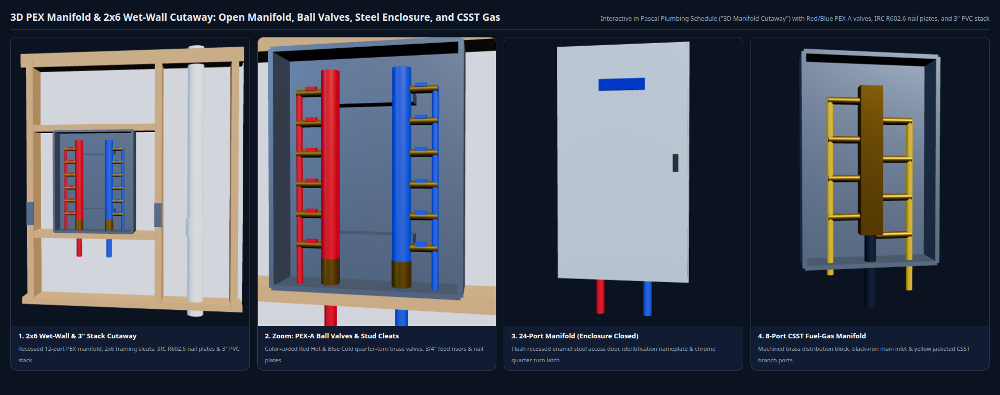
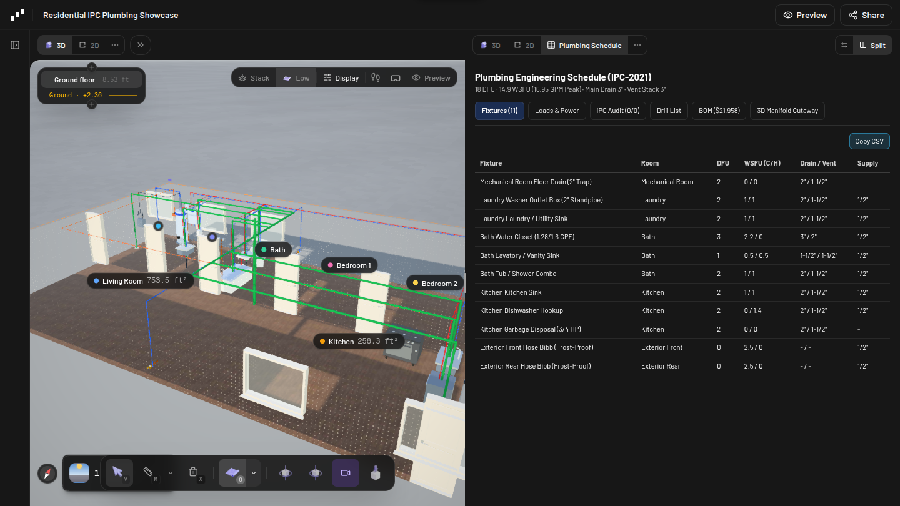
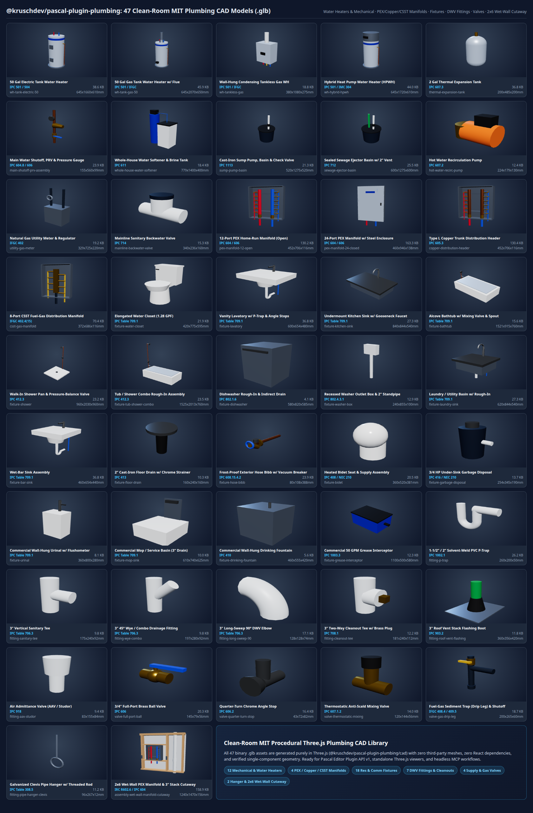

# Pascal Plugin Plumbing (`@kruschdev/pascal-plugin-plumbing`)

[](./LICENSE)
[](https://github.com/pascalorg/editor)
[](./docs/CAD-CATALOG.md)
[](./src/__tests__)

An open-source, MIT-licensed **Residential and Light-Commercial IPC / UPC / IFGC / IRC Plumbing** plugin for [Pascal Editor](https://github.com/pascalorg/editor).

I built this as a standalone external plugin implementing Pascal's full Plugin API v1 contract (`E-014`, `E-016`, `E-017`) so it installs cleanly alongside `@pascal-app/plugin-bones` and [`@kruschdev/pascal-plugin-electrical`](https://github.com/kruschdev/pascal-plugin-electrical) without requiring upstream core merges.

> [!NOTE]
> **Early Development Status:** This plugin is still in the beginning stages of being refined and is not yet at the same level of polish, depth, or completeness as my [Pascal Electrical Plugin (`@kruschdev/pascal-plugin-electrical`)](https://github.com/kruschdev/pascal-plugin-electrical). Expect active iteration on layout rules, 3D routing, and edge cases as I continue building it out.

## Walkthrough Video (Recorded Live in Pascal Editor)


**[Watch Full 720p HD Narrated Walkthrough Video Recorded in Pascal Editor (`assets/demo-walkthrough.mp4`)](./assets/demo-walkthrough.mp4)**

1. **One-Click IPC/UPC Auto-Populate and Bones Interop**: Scans Pascal room zones, placed Pascal bathroom/kitchen/laundry fixtures, and optional `@pascal-app/plugin-bones` `bones:framing` and `bones:service` (`water-heater`, `water-entry`, `sewer-exit`) anchors to place mechanical equipment, PEX home-run manifolds (or trunk-and-branch copper/PEX), wet-wall fixture rough-ins, frost-proof hose bibbs with anti-siphon vacuum breakers, gravity-sloped DWV drains, 3" roof vent stacks, dry re-vents (`>= 6"` above flood-level rim), optional IFGC fuel gas, and 4" rigid aluminum dryer vents.
2. **Priority #2 MEP Right-of-Way and Gravity DWV Routing**: Plumbing holds first MEP right-of-way (`1. Structural -> 2. Plumbing -> 3. HVAC -> 4. Electrical`) with true monotonic downward gravity pitch (`1/4"/ft` for `<= 2-1/2"`, `1/8"/ft` minimum for `>= 3"`), automatic detours around structural beams and columns (`structural:beam`, `structural:column`, `beam`, `column`; `stair`, `window`, and `door` openings are not yet extracted as 3D obstacles), and enforcement of **NEC 110.26(E) Dedicated Electrical Space** above electrical panels and transformers.
3. **Bones Framing Penetration Solver and 3D Bore Visualization**: Computes the exact 3D `(x, y, z)` crossing of every `16"` or `24"` OC wall stud, sole plate, and double top plate (honoring Priority #1 `structural:assembly` `2x6` overrides; `IRC R502.8` floor-joist boring is not modeled), renders 3D bore-hole collars and galvanized steel nail plates (`IRC R602.6` / `IPC 305.6`) right on pipe runs, and generates a live **Framing Drill List** with exact hole-saw diameters and `% of stud depth`.
4. **Automatic Cross-Trade Electrical Power Coordination**: Every powered plumbing unit (electric/HPWH water heater, tankless gas ignition/blower, sump pump, sewage ejector, recirc pump, water softener, dishwasher, garbage disposal, clothes washer, bidet) publishes a standardized `electricalDemand` payload (`voltage`, `poles`, `breakerAmps`, `loadVa`, `dedicatedCircuit`, `gfciRequired`). When `@kruschdev/pascal-plugin-electrical` runs in the same scene, Electrical automatically allocates the dedicated breakers on the panelboard and routes 3D power runs straight to each plumbing unit.
5. **Interactive 3D PEX Manifold & 2x6 Wet-Wall Cutaway and 47 Clean-Room MIT 3D CAD Models**: Place any of 33 live equipment, manifold, and fixture kinds (`12` equipment units, `3` manifolds, `18` residential and commercial fixtures) from the Plumbing rail or `plumbing_*` agent tools, and inspect the interactive **3D PEX Manifold & 2x6 Wet-Wall Cutaway** (`2x6 Wet-Wall & 3" Stack Cutaway`, `Manifold Cover Off`, `Steel Enclosure Closed`) inside the 6-tab split-pane `Plumbing Schedule` view.
6. **Live Fixture Schedule, DFU/WSFU/Gas Load Calc, IPC/IFGC Audit, and Priced BOM Takeoff**: Calculates `IPC Table 709.1` / `710.1` DFU drain sizing, Modified Hunter's Curve peak GPM, Hazen-Williams head loss and velocity limits (`<= 5 ft/s` hot copper, `<= 8 ft/s` cold/PEX), `IFGC Table 402.4` longest-length fuel-gas sizing, `IRC M1502.4` dryer vent effective length, and live labor/markup/tax BOM exports (CSV).

## Showcase Gallery








### 47-Model Clean-Room MIT CAD Library (6 Categories)

| Category | Count | Included Highlights |
|---|---|---|
| **Water Heaters and Mechanical Equipment** | 12 | 50 gal Electric/Gas Tank Water Heaters, Condensing Tankless Gas WH, Hybrid Heat Pump WH (HPWH), 2 gal Thermal Expansion Tank, Main Shutoff + PRV + Gauge, Whole-House Water Softener, Sump Pump Basin, Sealed Sewage Ejector Basin, Hot Water Recirc Pump, Natural Gas Utility Meter, Mainline Backwater Valve |
| **PEX and Fuel-Gas Manifolds** | 4 | 12-Port PEX Home-Run Manifold (Open), 24-Port PEX Manifold w/ Steel Enclosure, Type L Copper Trunk Distribution Header, 8-Port CSST Fuel-Gas Distribution Manifold |
| **Residential and Commercial Fixtures** | 18 | Elongated Water Closet, Vanity Lavatory w/ P-Trap, Undermount Kitchen Sink, Alcove Bathtub, Walk-In Shower, Tub/Shower Combo, Dishwasher Rough-In, Recessed Washer Box & 2" Standpipe, Laundry Sink, Wet-Bar Sink, 2" Floor Drain, Frost-Proof Hose Bibb w/ Vacuum Breaker, Heated Bidet Seat, 3/4 HP Garbage Disposal, Commercial Urinal, Mop Basin, Drinking Fountain, 50 GPM Grease Interceptor |
| **DWV Fittings and Cleanouts** | 7 | Solvent-Weld PVC P-Trap, 3" Vertical Sanitary Tee, 3" 45-Degree Wye/Combo, 3" Long-Sweep 90-Degree Elbow, 3" Two-Way Cleanout Tee w/ Brass Plug, 3" Roof Vent Flashing Boot, Air Admittance Valve (AAV / Studor) |
| **Supply and Fuel-Gas Valves** | 4 | 3/4" Full-Port Brass Ball Valve, Quarter-Turn Chrome Angle Stop, Thermostatic Anti-Scald Mixing Valve, Fuel-Gas Sediment Trap (Drip Leg) & Shutoff |
| **Pipe Runs, Hangers and Cutaway Assemblies** | 2 | Galvanized Clevis Pipe Hanger w/ Threaded Rod, 2x6 Wet-Wall PEX Manifold & 3" PVC Stack Cutaway (plus swept `buildPipeRunCad` with 3D stud bore collars and wall-normal steel nail plates) |

> **Drafting and engineering aid, not stamped engineering.** Always verify calculations, pipe sizing, and local AHJ amendments with a licensed plumbing engineer or master plumber before construction.

## Documentation

| Guide | What It Covers |
|---|---|
| **[Architecture Guide](./docs/ARCHITECTURE.md)** | Layered subpath boundaries, 4 `plumbing:*` node kinds, Bones framing interop, and cross-trade electrical power handoff |
| **[IPC / UPC / IFGC / IRC Engineering Reference](./docs/IPC-REFERENCE.md)** | Every implemented IPC/UPC/IFGC/IRC table and rule (`709.1`, `710.1`, `704.1`, `706.3`, `708.1`, `903.1`, `906.1`, `909.1`, `E103.3`, `504.6`, `607.3`, `608.15.4.2`, `IRC R602.6`, `IFGC 402.4`, `IRC M1502.4`, `NEC 110.26(E)`) |
| **[47-Model MIT 3D CAD Catalog](./docs/CAD-CATALOG.md)** | Full inventory of all 47 procedural `.glb` models across 6 categories and programmatic `./cad` usage |
| **[Agent Tools Reference (`E-016`)](./docs/AGENT-TOOLS.md)** | All 8 pure Zod agent tools and headless scene operations for MCP servers, chat workflows, and detached runtimes |
| **[Media Kit and Launch Copy](./docs/MEDIA-KIT.md)** | Ready-to-share social preview (`1280 x 640`), HD narrated walkthrough video, high-res screenshots, CAD contact sheet, and X / LinkedIn / Show HN / Discord / OSArch launch copy |
| **[Walkthrough Voiceover Script](./docs/WALKTHROUGH-SCRIPT.md)** | Timed ~60-second narration beat sheet and one-command Gemini TTS (`gemini-3.8-flash-tts`) + `ffmpeg` muxing script (`scripts/add-voiceover.sh`) |

## Package Entrypoints

| Entrypoint | Export | Boundary Guarantee |
|---|---|---|
| `.` | `plumbingPlugin`, `plumbingHostPanel`, `plumbingScheduleView`, `plumbingChatExtension` | Full editor integration (`EditorHostPanel`, 6-tab `EditorHostView`, `InspectorExtension`, chat cards) |
| `./render` | `plumbingRenderPlugin` | Editor-free read-only viewer manifest (verified by `bun run check:render`) |
| `./cad` | `PLUMBING_CAD_CATALOG`, `buildPlumbingCadPart`, `buildWiredManifoldCutawayCad`, `buildEquipmentCad`, `buildFixtureCad`, `buildFittingCad`, `buildPipeRunCad` | Editor-free, React-free Three.js CAD part builders for all 47 plumbing models |
| `./ipc` | Pure IPC/UPC/IFGC/IRC sizing, gravity DWV & supply routing, Bones penetration solver, audit, schedule, and BOM functions | Framework-free TypeScript (zero React, Three.js, or `@pascal-app/*`) |
| `./agent-tools` | `plumbingAgentTools` (`PluginAgentTools`, `E-016`) | Pure Zod-only contracts (8 tools + skill) |
| `./agent-operations` | `plumbingAgentOperations` (`AgentOperations`, `E-016`) | Pure scene operations runnable on MCP, detached runtime, or live chat |

## Quick Start in a Pascal Host

```ts
import { extendPluginDiscovery } from '@pascal-app/core'
import { registerEditorHostPanel, registerEditorHostView } from '@pascal-app/editor'
import {
  plumbingHostPanel,
  plumbingPlugin,
  plumbingScheduleView,
} from '@kruschdev/pascal-plugin-plumbing'

extendPluginDiscovery(async () => [plumbingPlugin])
registerEditorHostPanel(plumbingHostPanel)
registerEditorHostView(plumbingScheduleView)
```

For read-only viewers (zero `@pascal-app/editor` bundle overhead):

```ts
import { setPluginDiscovery } from '@pascal-app/core'
import { plumbingRenderPlugin } from '@kruschdev/pascal-plugin-plumbing/render'

setPluginDiscovery(async () => [plumbingRenderPlugin])
```

## Development and Verification

```bash
bun install
bun run check                                  # tsc --noEmit + bun test src (47/47 tests) + 5/5 boundary gates + dist/ build
bun run export:cad                             # Regenerate all 47 binary .glb models + catalog.json in assets/cad/
bun scripts/render-cad-thumbnails.ts           # Re-render all 47 thumbnails + 5x10 studio contact sheet
bun scripts/render-manifold-cutaway-closeup.ts # Re-render 4-panel 3D PEX manifold & 2x6 wet-wall cutaway showcase
PASCAL_EDITOR_URL=http://localhost:3210/project/<id> bun run render:walkthrough # Re-render demo-walkthrough.mp4 & .gif
bun scripts/render-social-preview.ts           # Re-render 1280x640 OpenGraph / GitHub Social Preview banner
bash scripts/add-voiceover.sh --voice Charon   # Synthesize & mux Gemini TTS voiceover
```

## License

MIT. Created by Kevin Ruschman ([@kruschdev](https://github.com/kruschdev)).
